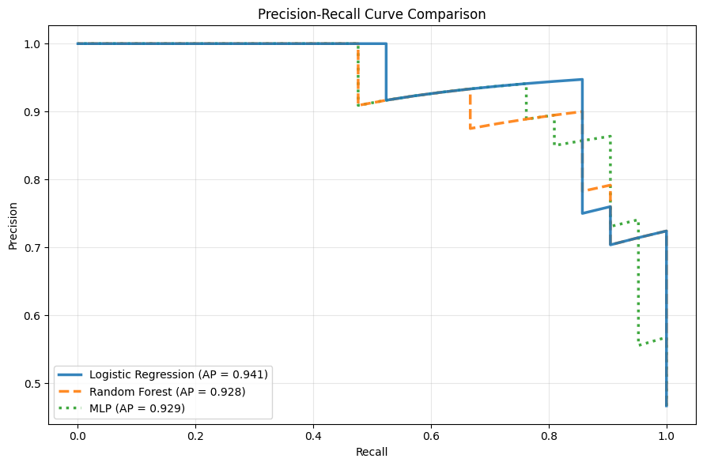
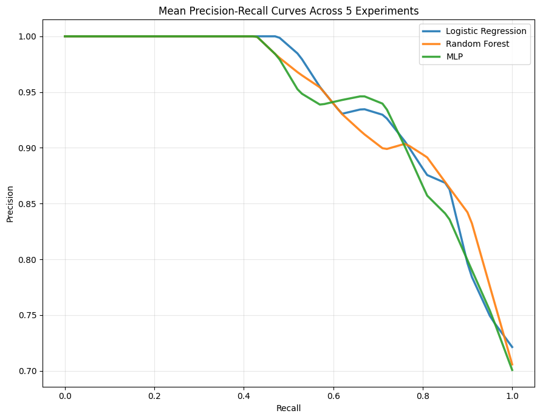

# Heart Disease Prediction

## Overview

This project explores binary heart disease classification using machine learning. Three models are trained and compared: Logistic Regression, Random Forest, and a Multi-Layer Perceptron (MLP) implemented with PyTorch.

The main objective is to prioritize **recall** while balancing it against precision, reducing false negatives while limiting false positives. Decision thresholds are selected using a weighted combination of recall and precision, with greater weight assigned to recall.

## Models

- **Logistic Regression** — a linear baseline for binary classification.
- **Random Forest** — an ensemble of decision trees capable of capturing nonlinear relationships.
- **Multi-Layer Perceptron (MLP)** — a neural network implemented with PyTorch.

## Methodology

### 1. Data preprocessing

- Convert the original target into a binary classification task: healthy (`0`) versus heart disease (`1`).
- Split the dataset into training (70%), validation (15%), and test (15%) sets using stratified sampling.
- Standardize the input features using `StandardScaler`, fitted exclusively on the training set.

### 2. Model training

Each model is trained on the training set. Hyperparameter selection is performed where applicable, including cross-validation for Logistic Regression and Random Forest.

The MLP is implemented in PyTorch and trained using cross-entropy loss. Its training process uses validation loss for model selection.

### 3. Threshold selection

The default classification threshold of 0.5 is not necessarily optimal for this task.

For each model, the decision threshold is selected using the validation set to maximize a weighted score combining recall and precision:

`score = 0.8 × recall + 0.2 × precision`

This approach gives greater importance to recall while still accounting for precision. The selected threshold is then applied unchanged to the test set.

### 4. Evaluation

Models are evaluated using:

- **Accuracy**
- **Precision**
- **Recall**
- **F1-score**
- **Log loss**
- **Average Precision (AP)**

Confusion matrices and precision-recall curves are also used to analyze model performance.

## Results

### 1. Initial comparison: `random_state=40`

The following results were obtained on a single held-out test set using `random_state=40`.

| Metric | Logistic Regression | Random Forest | MLP |
|---|---:|---:|---:|
| Decision threshold | 0.1518 | 0.1379 | 0.2057 |
| Log loss | **0.3155** | 0.3702 | 0.3432 |
| Accuracy | 0.7778 | 0.7111 | **0.8222** |
| Precision | 0.6774 | 0.6176 | **0.7407** |
| Recall | **1.0000** | **1.0000** | 0.9524 |
| F1-score | 0.8077 | 0.7636 | **0.8333** |
| Average Precision | **0.9407** | 0.9285 | 0.9288 |



#### Discussion

On this initial split, Logistic Regression and Random Forest both achieve a recall of 1.0, meaning that no positive cases are missed on this particular test set. However, Logistic Regression outperforms Random Forest in precision, accuracy, F1-score, log loss, and Average Precision.

The MLP achieves the highest accuracy, precision, and F1-score, while maintaining a recall of 0.9524. However, the precision-recall curves show that the three models have relatively similar overall performance, as reflected by their Average Precision scores. At the recall selected for the MLP (0.9524), Logistic Regression achieves lower precision, illustrating the trade-off between detecting more positive cases and limiting false positives. Overall, the MLP appears particularly competitive on this split, whereas Random Forest seems to be the weakest model.

However, these results reflect only one train-validation-test split. They may therefore be influenced by the specific samples assigned to each subset and do not necessarily represent the models' typical performance. This motivates a robustness analysis across multiple random seeds.

### 2. Robustness analysis: five experiments

To evaluate how consistently the models perform across different data splits, the experiments are repeated with five random seeds: `40`, `41`, `42`, `43`, and `44`.

For each seed, stratified sampling is used to create training, validation, and test sets. The decision threshold is optimized on the validation set using the same weighted score as in the main experiment, then kept fixed for evaluation on the test set.

The results below summarize the mean and sample standard deviation of each test metric across the five runs. The precision-recall curves provide a complementary view of the trade-off between precision and recall across decision thresholds.

| Model | Threshold | Loss | Accuracy | Precision | Recall | F1-score | Average Precision |
|---|---:|---:|---:|---:|---:|---:|---:|
| Logistic Regression | 0.1470 ± 0.0410 | 0.3376 ± 0.0972 | 0.7644 ± 0.0696 | 0.6846 ± 0.0706 | 0.9524 ± 0.0673 | 0.7927 ± 0.0425 | 0.9351 ± 0.0352 |
| Random Forest | 0.2306 ± 0.1050 | 0.3594 ± 0.0409 | 0.7511 ± 0.0596 | 0.6926 ± 0.0914 | 0.9048 ± 0.1347 | 0.7729 ± 0.0346 | 0.9344 ± 0.0252 |
| MLP | 0.1670 ± 0.0502 | 0.3420 ± 0.0880 | 0.7467 ± 0.1213 | 0.6815 ± 0.1026 | 0.9333 ± 0.0797 | 0.7809 ± 0.0698 | 0.9306 ± 0.0383 |



#### Discussion

The robustness analysis provides a more representative comparison than the initial split alone. The mean Precision-Recall curves show that the three models have broadly comparable performance, with mean Average Precision scores of:

- **Logistic Regression:** 0.9351 ± 0.0352
- **Random Forest:** 0.9344 ± 0.0252
- **MLP:** 0.9306 ± 0.0383

The differences in Average Precision are small. However, the mean Precision-Recall curves reveal differences in the recall ranges where each model performs best.

Random Forest performs particularly well over a recall range of approximately 0.75 to 0.95, making it a potentially attractive option when very high recall is not an absolute requirement. Logistic Regression appears more suitable when recall above approximately 0.95 is the priority. The MLP performs relatively well over a narrower range, approximately between 0.60 and 0.75, which is less relevant to the project's high-recall objective.

These findings also illustrate why the initial comparison should not be considered conclusive. Random Forest appeared substantially weaker on the `random_state=40` split, but the five-experiment analysis shows that it can be competitive across a broader range of recall values. Similarly, the MLP's strong initial results do not translate into a clear overall advantage across the repeated experiments.

Overall, Logistic Regression appears to be the most suitable candidate when prioritizing very high recall, while Random Forest remains a relevant alternative when there is greater flexibility in the recall target. The MLP does not demonstrate a clear advantage for the current objective.

These conclusions remain tentative because the dataset is small and the robustness analysis uses only five splits.

## Limitations

- The dataset is relatively small, which limits the models' ability to generalize to unseen data.
- Performance depends on the particular train-validation-test split.
- A small test set can produce substantial variation in reported metrics.
- Threshold selection on the validation set does not guarantee the same precision or recall on unseen data.
- The MLP is selected based on validation loss, which may not correspond to the best precision-recall trade-off after threshold optimization.

## Future Improvements

- Evaluate robustness across more random seeds or use stratified cross-validation.
- Investigate class weighting and alternative training strategies for the MLP.
- Explore data augmentation techniques suitable for tabular data.
- Assess performance on an independent external dataset.
- Improve model interpretability and analyze false-negative cases.

## Project Structure

```text
heart-disease-prediction/
├── notebooks/
│   ├── data_exploration.ipynb
│   ├── model_comparison.ipynb
│   └── robustness_analysis.ipynb
├── src/
│   ├── data_cleaning.py
│   ├── evaluation.py
│   └── models.py
├── README.md
└── requirements.txt
```

## Installation

Clone the repository:

```bash
git clone https://github.com/samy-bouchentouf/heart-disease-prediction.git
cd heart-disease-prediction
```

Install the dependencies:

```bash
pip install -r requirements.txt
```

Download `processed.cleveland.data` from the [UCI Heart Disease dataset](https://archive.ics.uci.edu/dataset/45/heart+disease).

Create a `data/` directory at the root of the project and place the downloaded file inside it.

The directory structure should include:

```text
heart-disease-prediction/
├── data/
│   └── processed.cleveland.data
├── notebooks/
├── src/
├── README.md
└── requirements.txt
```

Launch Jupyter Notebook:

```bash
jupyter notebook
```

Open the notebooks in the `notebooks/` directory and execute the cells in order.

## Technologies

- Python
- pandas
- NumPy
- scikit-learn
- PyTorch
- Matplotlib
- Jupyter Notebook